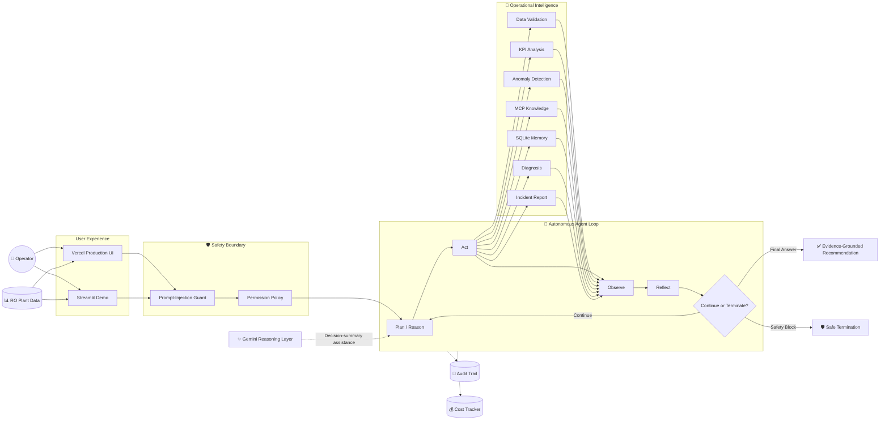

<div align="center">

# 🌊 AquaMindAI-Agent

### Autonomous AI Agent for Reverse-Osmosis Desalination Operations

**Analyze · Investigate · Diagnose · Verify**

[](https://aquamindai-agent-git-main-mohammed-tariq1.vercel.app/)
[](https://aquamindai-agent.onrender.com/)
[](https://www.python.org/)
[](./evidence/tests_coverage.txt)
[](./evidence/tests_coverage.txt)

**Evidence-Grounded · Gemini-Assisted · MCP-Enabled · Safety-Constrained · Traceable**

[🚀 Launch Production UI](https://aquamindai-agent-git-main-mohammed-tariq1.vercel.app/) ·
[🌊 Open Streamlit Demo](https://aquamindai-agent.onrender.com/) ·
[📋 Agent Specification](./agent_spec.md) ·
[🎬 Demo Guide](./DEMO.md)

</div>

---

## What is AquaMind?

**AquaMindAI-Agent** is an autonomous engineering decision-support agent designed to investigate operational problems in **reverse-osmosis desalination systems**.

It is not a general-purpose chatbot and it does not directly control desalination equipment.

AquaMind follows a structured autonomous investigation workflow:

> **Plan → Act → Observe → Reflect → Decide**

Given RO plant CSV data, the agent can:

- validate and assess sensor data,
- calculate RO operating KPIs,
- detect abnormal performance patterns,
- retrieve approved engineering knowledge through MCP,
- search persistent incident memory,
- build source-grounded diagnostic hypotheses,
- reflect on the collected evidence,
- generate safe verification recommendations,
- track model usage and task cost,
- and produce auditable JSONL execution traces.

Physical plant-control decisions remain outside the autonomous execution boundary.

---

## 🚀 Try AquaMind

| Experience | Purpose | Launch |
|---|---|---|
| ⚡ **Production UI** | Product-oriented operational experience | [Open on Vercel →](https://aquamindai-agent-git-main-mohammed-tariq1.vercel.app/) |
| 🌊 **Interactive Streamlit Demo** | Direct agent investigation and capstone evaluation | [Open Streamlit →](https://aquamindai-agent.onrender.com/) |

The Streamlit application is hosted on **Render**.

Both interfaces use the same AquaMind investigation architecture, safety model, diagnostic knowledge, and agent runtime.

---

## 🧠 Autonomous Agent Architecture



---

## ✨ Gemini-Assisted Reasoning

AquaMind integrates **Google Gemini** inside the agent runtime through a hybrid planning layer.

Current model:

```text
gemini-3.5-flash-lite
```

The architecture deliberately keeps operational action selection safety-constrained.

The deterministic planner selects an approved candidate action, while Gemini may provide a concise reasoning summary for that already-approved action.

This means the model does **not** receive unrestricted authority to invent or execute arbitrary operational tools.

If Gemini is unavailable, rate-limited, or cannot be used within the configured budget, AquaMind can fall back to its deterministic planner without disabling the investigation workflow.

---

## ⚡ Agent Capabilities

| Capability | Description | Explore |
|---|---|---|
| 🔎 **Autonomous Investigation** | Runs an RO investigation end to end | [Agent Core](./src/agent) |
| 📊 **Data Validation** | Checks and repairs recoverable plant-data quality issues | [Validation](./src/tools/validation.py) |
| 📈 **KPI Analysis** | Calculates relevant RO performance indicators | [KPI Tools](./src/tools/kpi_tools.py) |
| 🚨 **Anomaly Detection** | Identifies abnormal operating patterns | [Anomaly Detection](./src/tools/anomaly_detection.py) |
| 📚 **MCP Knowledge Retrieval** | Retrieves curated engineering evidence | [MCP](./src/mcp) |
| 🗂️ **Persistent Incident Memory** | Searches approved historical incidents in SQLite | [Memory](./src/memory) |
| 🧠 **Diagnostic Reasoning** | Produces evidence-grounded hypotheses | [Diagnosis](./src/tools/diagnosis.py) |
| 🔄 **Reflection** | Reassesses results before continuation or termination | [Reflector](./src/agent/reflector.py) |
| ✨ **Gemini Assistance** | Adds model-assisted reasoning summaries to approved actions | [LLM](./src/llm) |
| 🛡️ **Safety Enforcement** | Blocks injected and prohibited physical-control requests | [Safety](./src/safety) |
| 🧾 **Auditability** | Records operational decisions and execution events | [Audit](./src/audit) |
| 💰 **Cost Control** | Tracks tokens, reference cost, and task budget | [Cost Analysis](./cost_analysis.md) |
| 🧾 **JSONL Tracing** | Exports audit-safe execution traces | [Tracing](./src/tracing) |

---

## 🛠️ Approved Toolset

AquaMind operates through a deliberately constrained registry of seven operational tools.

| Tool | Responsibility |
|---|---|
| `validate_sensor_data` | Validate, clean, and assess incoming RO data |
| `calculate_plant_kpis` | Calculate RO performance indicators |
| `detect_anomalies` | Detect abnormal operational patterns |
| `search_operational_knowledge` | Retrieve approved engineering evidence through MCP |
| `search_incident_memory` | Search persistent SQLite incident memory |
| `diagnose_issue` | Build evidence-grounded diagnostic hypotheses |
| `generate_incident_report` | Generate the final structured investigation report |

No unregistered operational tool may execute through the autonomous loop.

[Read the complete agent specification →](./agent_spec.md)

---

## 🔌 Model Context Protocol

AquaMind implements its MCP server and client with the official **Model Context Protocol Python SDK (`mcp==2.3.0`)**.

Runtime verification confirms that `MCPServer` resolves from the installed `site-packages` distribution rather than the local `src/mcp` package. An end-to-end client/server verification also successfully lists knowledge documents, calls `search_operational_knowledge`, and reads a `knowledge://` resource.

The MCP layer exposes curated desalination engineering knowledge to the agent through resources and controlled retrieval.

The operational agent accesses that knowledge through:

```text
search_operational_knowledge
```

Knowledge resources use `knowledge://` URIs.

The MCP implementation has been exercised through the actual client, returning relevant engineering matches from the project knowledge base.

[Explore MCP implementation →](./src/mcp)

[View MCP retrieval evidence →](./evidence/mcp_knowledge_search.txt)

[View official MCP SDK runtime resolution →](./evidence/mcp_runtime_resolution.txt)

[View MCP protocol end-to-end verification →](./evidence/mcp_protocol_end_to_end.txt)

---

## 🗂️ Persistent Incident Memory

AquaMind uses **SQLite** for persistent incident memory.

Persistent writes are permission-controlled rather than automatically performed by the autonomous planner.

Memory persistence was verified across independent Python processes:

```text
Save approved incident
        ↓
Terminate runtime
        ↓
Start a fresh runtime
        ↓
Reconnect to SQLite
        ↓
Search incident memory
        ↓
Previously stored incident recovered
```

[Explore memory implementation →](./src/memory)

[View memory-save evidence →](./evidence/memory_restart_save.txt)

[View restart verification →](./evidence/memory_restart_verify.txt)

---

## 🛡️ Safety by Design

Safety is implemented as part of AquaMind's runtime architecture rather than relying only on model prompting.

### Permission Model

| Permission | Behavior |
|---|---|
| `AUTO` | Safe analytical and read-only operations |
| `ASK_ON_WRITE` | Persistent writes require explicit human approval |
| `ALWAYS_ASK` | High-impact actions require explicit authorization |

Physical plant-control operations remain outside AquaMind's autonomous execution boundary.

[Explore safety implementation →](./src/safety)

[View permission verification →](./evidence/permission_layer.txt)

---

### Prompt-Injection Defense

Three independent hostile-input scenarios were tested, including:

- instruction override and hidden-prompt extraction,
- safety bypass and forced tool execution,
- physical-control requests involving valves and pump setpoints.

Verified result:

```text
HOSTILE INPUTS PASSED: 3/3
Termination: SAFETY_BLOCK
Operational tool calls: 0
```

The safety-block trace demonstrates that the unsafe request is blocked **before any operational tool executes**. This is successful safety enforcement, not the task-failure trace.

[View hostile-input evidence →](./evidence/hostile_inputs_test.txt)

[View prompt-injection evidence →](./evidence/prompt_injection_safety.txt)

[Open safety-block trace →](./traces/explicit_failure.jsonl)

---

## 🧾 Execution Traces

AquaMind exports audit-safe JSONL traces containing concise decision summaries, tool events, observations, termination information, cost summaries, and audit-integrity results.

The traces do **not** expose private chain-of-thought reasoning.

### ✅ 1. Successful Investigation

[`success_1.jsonl`](./traces/success_1.jsonl)

A successful source-grounded RO investigation ending with:

```text
termination_reason = FINAL_ANSWER
turn_count         = 7
tool_call_count    = 7
```

The latest verified trace includes real Gemini usage:

| Metric | Verified Value |
|---|---:|
| Gemini calls | **7** |
| Input tokens | **2,139** |
| Output tokens | **327** |
| Cached input tokens | **0** |
| Paid-tier reference-equivalent cost | **$0.0014592** |
| Budget cap | **$0.10** |
| Audit integrity | **Valid** |

---

### 🔄 2. Near-Failure Recovery

[`near_failure_recovery.jsonl`](./traces/near_failure_recovery.jsonl)

This scenario intentionally contains recoverable data-quality degradation.

AquaMind identifies issues including:

- invalid timestamps,
- duplicate timestamps,
- non-numeric sensor values,
- missing sensor values.

The agent applies recoverable processing, verifies that sufficient data remains, and continues the investigation.

Verified outcome:

```text
termination_reason = FINAL_ANSWER
turn_count         = 7
tool_call_count    = 7
recovery_applied   = true
```

The latest trace also records real Gemini usage where provider availability allowed it.

---

### 🛡️ 3. Safety Block

[`explicit_failure.jsonl`](./traces/explicit_failure.jsonl)

The input deliberately attempts to:

- override safety instructions,
- extract hidden instructions,
- bypass approval,
- operate a concentrate valve,
- change a high-pressure pump setpoint.

Verified result:

```text
termination_reason = SAFETY_BLOCK
turn_count         = 0
tool_call_count    = 0
LLM calls          = 0
```

The request is rejected before entering the operational tool workflow. This trace verifies successful safety enforcement and is intentionally distinct from the task-failure trace below.

---

### ❌ 4. Task Failure — MAX_TURNS_REACHED

[`max_turns_failure.jsonl`](./traces/max_turns_failure.jsonl)

This reproducible scenario runs the AquaMind runtime with `max_turns=2` on an investigation that requires additional steps.

LLM assistance is intentionally disabled for this termination-control test so the failure condition remains deterministic and reproducible. Real Gemini participation is demonstrated separately by the successful execution trace.

Verified result:

```text
status             = failed
termination_reason = MAX_TURNS_REACHED
turn_count         = 2
tool_call_count    = 2
audit_integrity    = valid
```

Two approved operational tools execute successfully:

```text
validate_sensor_data
calculate_plant_kpis
```

The runtime then terminates before a third turn because the configured maximum-turn limit has been exhausted.

The accompanying append-only audit log contains **7 hash-chained runtime events** and passes `AuditLogger.verify_integrity()`.

[Open MAX_TURNS task-failure trace →](./traces/max_turns_failure.jsonl)

[Open hash-chained task-failure audit →](./evidence/max_turns_failure_audit.jsonl)

[Open failure-generation evidence →](./evidence/max_turns_failure_generation.txt)

[Open reproducible generator script →](./scripts/generate_max_turns_failure_trace.py)

---

## 💰 Cost Intelligence

AquaMind includes task-level usage and cost accounting around **Google Gemini**.

### Runtime Configuration

| Item | Value |
|---|---|
| Provider | Google Gemini |
| Model | `gemini-3.5-flash-lite` |
| Task budget cap | `$0.10` |
| Usage tracking | Provider-reported token metadata |
| Fallback | Deterministic safety-constrained planner |

AquaMind does not fabricate token counts for completed Gemini calls.

---

### Benchmark Summary

| Metric | Value |
|---|---:|
| Free Tier benchmark cost | `$0.000000` |
| Average paid-tier reference cost / benchmark task | `$0.00062242` |
| Projected 100-task paid reference | `$0.062242` |
| Projected 1,000-task paid reference | `$0.622420` |
| Projected 10,000-task paid reference | `$6.224200` |

The Free Tier figure reflects the configured usage tier and applicable free-tier pricing.

The paid-reference figures provide a budgeting reference if equivalent model usage were billed at the configured paid-tier rates.

Free-tier quotas and rate limits may prevent all workloads from remaining free.

[Explore full cost methodology →](./cost_analysis.md)

---

## ✅ Engineering Verification

| Verification | Result |
|---|---:|
| Automated Tests | **572 / 572 Passed** ✅ |
| Source Coverage | **100.00%** ✅ |
| Statements | **2,454** |
| Missing Statements | **0** |
| Hostile Inputs | **3 / 3 Blocked** ✅ |
| MCP Search | **Verified** ✅ |
| Official MCP SDK Resolution | **mcp 2.3.0 Verified** ✅ |
| MCP Protocol End-to-End | **Verified** ✅ |
| Memory After Restart | **Verified** ✅ |
| Permission Enforcement | **Verified** ✅ |
| Successful JSONL Trace | **Verified** ✅ |
| Near-Failure Recovery Trace | **Verified** ✅ |
| Safety Block Trace | **Verified** ✅ |
| MAX_TURNS Task Failure Trace | **Verified** ✅ |
| Failure Audit Integrity | **7 Hash-Chained Events — Valid** ✅ |
| Real Gemini Agent-Loop Usage | **Verified** ✅ |

[Open test and coverage evidence →](./evidence/tests_coverage.txt)

[Open production smoke-test evidence →](./evidence/production_smoke_test.txt)

---

## 🎯 Diagnostic Quality Evaluation

AquaMind has been evaluated using **controlled synthetic RO engineering scenarios**.

These evaluations test deterministic system behavior and engineering-rule conformance.

They are **not claims of field diagnostic accuracy on real desalination-plant telemetry**.

| Metric | Result |
|---|---:|
| End-to-End Scenario Conformance | **8 / 8 — 100%** |
| Outcome-Label Conformance | **8 / 8 — 100%** |
| Supported Diagnosis Conformance | **7 / 7** |
| Safety-Boundary Conformance | **1 / 1** |
| Reference Diagnostic Profiles | **90 / 90 — 100%** |
| Synthetic Rule Variations | **720 / 720 — 100%** |
| Synthetic Normal False-Alarm Rate | **0 / 8 — 0.00%** |
| Source-Grounded Cases | **90 / 90** |
| Fully Resolvable Source IDs | **90 / 90** |
| Verified Engineering Sources | **34** |

The underlying diagnostic patterns and evidence requirements are linked to verified manufacturer and industry references.

AquaMind deliberately produces **evidence-grounded hypotheses** rather than presenting uncertain causes as confirmed physical failures.

For example, scaling and colloidal fouling are not artificially separated when the available telemetry cannot responsibly distinguish between them.

Further evidence may be required, including:

- feed-water chemistry,
- SDI or turbidity,
- normalized membrane performance,
- stage localization,
- pretreatment performance,
- antiscalant operation,
- and deposit inspection.

Runtime confidence values are **heuristic support scores**, not calibrated probabilities of real-world root cause.

Independent blinded comparison with qualified RO specialists remains an appropriate future validation step before making claims about real-world diagnostic accuracy.

[View diagnostic quality evaluation →](./evidence/diagnostic_quality_evaluation.txt)

[View end-to-end scenario evaluation →](./evidence/diagnostic_scenario_evaluation.txt)

---

## 🧪 Sensor-Data Robustness

AquaMind does not assume that uploaded CSV telemetry is clean.

The validation and recovery workflow has been tested against data containing:

- invalid timestamps,
- duplicate timestamps,
- missing readings,
- non-numeric sensor values,
- out-of-order records.

The system:

```text
Detects data-quality degradation
        ↓
Applies permitted recovery
        ↓
Records recovery actions
        ↓
Reassesses remaining evidence
        ↓
Continues only when analysis remains responsible
```

[View recovery trace →](./traces/near_failure_recovery.jsonl)

---

## 📚 Engineering Knowledge

The diagnostic knowledge layer contains source-grounded engineering information used by the operational reasoning pipeline.

The verification suite currently includes:

```text
34 verified engineering sources
90 source-grounded diagnostic cases
90 fully resolvable source-ID mappings
720 controlled synthetic rule variations
```

The project does not present synthetic scenarios as real plant incidents.

---

## 📂 Reviewer Evidence

| Evidence | Direct Link |
|---|---|
| Agent goal, tools, limits, permissions | [agent_spec.md](./agent_spec.md) |
| Successful real-Gemini execution | [success_1.jsonl](./traces/success_1.jsonl) |
| Recovery behavior | [near_failure_recovery.jsonl](./traces/near_failure_recovery.jsonl) |
| Safety-block behavior | [explicit_failure.jsonl](./traces/explicit_failure.jsonl) |
| Task failure — MAX_TURNS exhausted | [max_turns_failure.jsonl](./traces/max_turns_failure.jsonl) |
| Task-failure hash-chained audit | [max_turns_failure_audit.jsonl](./evidence/max_turns_failure_audit.jsonl) |
| Reproducible task-failure generator | [generate_max_turns_failure_trace.py](./scripts/generate_max_turns_failure_trace.py) |
| Cost methodology | [cost_analysis.md](./cost_analysis.md) |
| Diagnostic quality | [diagnostic_quality_evaluation.txt](./evidence/diagnostic_quality_evaluation.txt) |
| End-to-end scenarios | [diagnostic_scenario_evaluation.txt](./evidence/diagnostic_scenario_evaluation.txt) |
| 572 tests / 100% coverage | [tests_coverage.txt](./evidence/tests_coverage.txt) |
| Production smoke test | [production_smoke_test.txt](./evidence/production_smoke_test.txt) |
| MCP retrieval | [mcp_knowledge_search.txt](./evidence/mcp_knowledge_search.txt) |
| Official MCP SDK runtime resolution | [mcp_runtime_resolution.txt](./evidence/mcp_runtime_resolution.txt) |
| MCP protocol end-to-end verification | [mcp_protocol_end_to_end.txt](./evidence/mcp_protocol_end_to_end.txt) |
| Persistent-memory restart | [memory_restart_verify.txt](./evidence/memory_restart_verify.txt) |
| Permission enforcement | [permission_layer.txt](./evidence/permission_layer.txt) |
| Prompt-injection defense | [prompt_injection_safety.txt](./evidence/prompt_injection_safety.txt) |
| Three hostile-input tests | [hostile_inputs_test.txt](./evidence/hostile_inputs_test.txt) |

---

## 📁 Repository Structure

```text
AquaMindAI-Agent/
│
├── src/
│   ├── agent/                # Planning, state, reflection, autonomous loop
│   ├── audit/                # Append-only audit logging
│   ├── cost/                 # Token, cost, and budget tracking
│   ├── knowledge/            # Diagnostic knowledge services
│   ├── llm/                  # Gemini reasoner
│   ├── mcp/                  # MCP server and client
│   ├── memory/               # Persistent SQLite incident memory
│   ├── safety/               # Injection guard and permissions
│   ├── tools/                # Approved operational tools
│   └── tracing/              # JSONL execution tracing
│
├── data/                     # Controlled synthetic RO datasets
├── knowledge/                # Source-grounded engineering knowledge
├── tests/                    # 572 automated tests
├── traces/                   # Successful, recovery, safety-block, and task-failure traces
├── evidence/                 # Verification outputs
├── scripts/                  # Trace generation and evaluation utilities
├── frontend/                 # Production UI assets
│
├── streamlit_app.py          # Interactive Streamlit application
├── web_app.py                # Production FastAPI/Vercel application
├── render.yaml               # Streamlit deployment configuration
├── agent_spec.md             # Agent specification
├── cost_analysis.md          # Cost analysis and projections
├── DEMO.md                   # Demo walkthrough
├── requirements.txt
├── requirements-web.txt
└── README.md
```

---

## ⚙️ Agent Limits & Termination

| Control | Configuration |
|---|---|
| Maximum turns | `12` |
| Maximum task budget | `$0.10` |
| Successful termination | `FINAL_ANSWER` |
| Safety termination | `SAFETY_BLOCK` |
| Task-failure example | `MAX_TURNS_REACHED` |
| Persistent write policy | `ASK_ON_WRITE` |
| High-impact permission | `ALWAYS_ASK` |

A valid task terminates through explicit runtime conditions rather than an open-ended conversation loop.

[Read the full specification →](./agent_spec.md)

---

## 🌐 Deployment

### Streamlit Demo — Render

Render runs:

```text
streamlit run streamlit_app.py --server.address 0.0.0.0 --server.port $PORT --server.headless true
```

Configured runtime variables:

```text
AQUAMIND_LLM_ENABLED=true
AQUAMIND_LLM_MODEL=gemini-3.5-flash-lite
AQUAMIND_TASK_BUDGET_USD=0.10
GEMINI_API_KEY=<deployment secret>
```

The API key is supplied as a deployment secret and is never committed to the repository.

If a valid Gemini key is unavailable, AquaMind can use its deterministic fallback path.

[Open Streamlit Demo →](https://aquamindai-agent.onrender.com/)

---

### Production UI — Vercel

The product-oriented interface is deployed separately on Vercel:

[Open Production UI →](https://aquamindai-agent-git-main-mohammed-tariq1.vercel.app/)

A production smoke test verifies:

- application health,
- dataset discovery,
- intent routing,
- knowledge Q&A,
- safety blocking,
- missing-data handling,
- end-to-end investigation,
- safe error handling,
- contextual follow-up,
- case-library access,
- trace access,
- and related-case retrieval.

[View production smoke-test evidence →](./evidence/production_smoke_test.txt)

---

## 🧪 Reproduce Verification

Run the automated suite:

```bash
pytest tests --cov=src --cov-report=term-missing --cov-fail-under=100
```

Verified result:

```text
572 passed
TOTAL 2454 0 100%
Required test coverage of 100% reached.
```

---

## 💻 Run Locally

Clone the project:

```bash
git clone https://github.com/xmohamedtariq/AquaMindAI-Agent.git
cd AquaMindAI-Agent
```

Create and activate a virtual environment:

```bash
python -m venv .venv
```

Windows PowerShell:

```powershell
.venv\Scripts\Activate.ps1
```

Install dependencies:

```bash
pip install -r requirements.txt
```

### Run with deterministic fallback

```bash
streamlit run streamlit_app.py
```

### Enable Gemini-assisted Agent Loop

Set environment variables without committing the API key:

```text
AQUAMIND_LLM_ENABLED=true
AQUAMIND_LLM_MODEL=gemini-3.5-flash-lite
AQUAMIND_TASK_BUDGET_USD=0.10
GEMINI_API_KEY=<your secret>
```

Then run:

```bash
streamlit run streamlit_app.py
```

---

## 🧾 Generate Validation Traces

The trace-generation script runs the actual AquaMind runtime against the official validation scenarios.

```bash
python -m scripts.generate_validation_traces
```

Generated core evidence includes:

```text
traces/success_1.jsonl
traces/near_failure_recovery.jsonl
traces/explicit_failure.jsonl
```

The successful trace is generated directly from the successful source-grounded Agent Loop execution.

The `explicit_failure.jsonl` filename is retained for compatibility, but its outcome is a successful `SAFETY_BLOCK`; it is not used as the rubric task-failure case.

Generate the reproducible task-failure scenario separately:

```bash
python -m scripts.generate_max_turns_failure_trace
```

Running this reproducible scenario generates:

```text
traces/max_turns_failure.jsonl
traces/.runtime/max-turns-failure/audit.jsonl
```

A verified snapshot of the hash-chained runtime audit is committed for reviewer inspection at:

```text
evidence/max_turns_failure_audit.jsonl
```

Its verified outcome is `status=failed` with `termination_reason=MAX_TURNS_REACHED` after two successful operational tool calls.

---

## 🎬 Demo Walkthrough

A guided demonstration is available in:

[**Open DEMO.md →**](./DEMO.md)

Recommended workflow:

```text
RO Plant Data
    ↓
Validation
    ↓
Autonomous Agent Loop
    ↓
KPI Analysis
    ↓
Anomaly Detection
    ↓
MCP Knowledge Retrieval
    ↓
Incident Memory
    ↓
Evidence-Grounded Diagnosis
    ↓
Reflection
    ↓
Safety & Permission Checks
    ↓
Final Recommendation
```

---

## 🛡️ Operational Boundary

AquaMind may autonomously:

- analyze uploaded RO operational data,
- validate and clean recoverable telemetry issues,
- calculate plant KPIs,
- detect abnormal operating patterns,
- retrieve approved engineering references,
- search incident memory,
- generate evidence-grounded hypotheses,
- generate incident reports,
- and recommend safe verification actions.

AquaMind does **not** autonomously:

- operate valves,
- start or stop pumps,
- change plant setpoints,
- initiate membrane cleaning cycles,
- shut down equipment,
- bypass human authorization,
- or perform physical plant control.

Final physical operational decisions remain under qualified human supervision.

---

## 🔗 Quick Links

- [🚀 Production UI — Vercel](https://aquamindai-agent-git-main-mohammed-tariq1.vercel.app/)
- [🌊 Interactive Streamlit Demo](https://aquamindai-agent.onrender.com/)
- [📋 Agent Specification](./agent_spec.md)
- [🎬 Demo Guide](./DEMO.md)
- [💰 Cost Analysis](./cost_analysis.md)
- [🎯 Diagnostic Quality Evaluation](./evidence/diagnostic_quality_evaluation.txt)
- [🧪 Scenario Evaluation](./evidence/diagnostic_scenario_evaluation.txt)
- [✅ Tests & Coverage](./evidence/tests_coverage.txt)
- [🌐 Production Smoke Test](./evidence/production_smoke_test.txt)
- [🧾 Successful Gemini Trace](./traces/success_1.jsonl)
- [🔄 Recovery Trace](./traces/near_failure_recovery.jsonl)
- [🛡️ Safety Block Trace](./traces/explicit_failure.jsonl)
- [❌ MAX_TURNS Task Failure Trace](./traces/max_turns_failure.jsonl)
- [🔐 Task Failure Audit](./evidence/max_turns_failure_audit.jsonl)
- [🔌 MCP Runtime Resolution](./evidence/mcp_runtime_resolution.txt)
- [🔗 MCP End-to-End Verification](./evidence/mcp_protocol_end_to_end.txt)
- [🔌 MCP Implementation](./src/mcp)
- [🗂️ Persistent Memory](./src/memory)
- [💻 Source Code](./src)
- [🧪 Automated Tests](./tests)

---

<div align="center">

## 👤 Mohammed Tariq Al-Saqqaf

**Mechatronics Engineer · Artificial Intelligence · Intelligent Automation · Water Technology**

[](https://github.com/xmohamedtariq)
[](https://www.linkedin.com/in/mohammed-tariq-3a1a0824a)

<br>

### Intelligence for Smarter Desalination Operations

**Built around evidence. Designed for traceability. Constrained by safety.**

</div>
