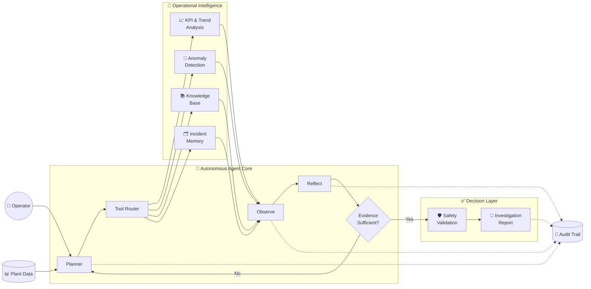

<div align="center">

# 🌊 AquaMindAI-Agent

### Autonomous AI Agent for Desalination Operations Intelligence

**Monitor · Investigate · Diagnose · Verify**

[](https://aquamindai-agent-git-main-mohammed-tariq1.vercel.app/)
[](https://www.python.org/)
[](./tests)
[](./tests)

**Evidence-Grounded · Safety-Constrained · Traceable**

[🚀 Live App](https://aquamindai-agent-git-main-mohammed-tariq1.vercel.app/) ·
[💻 Source](./src) ·
[📋 Specification](./SPEC.md) ·
[🧪 Tests](./tests) ·
[💰 Cost](./COST.md) ·
[🎬 Demo](./DEMO.md)

</div>

---

## Overview

**AquaMindAI-Agent** is an autonomous AI agent designed to support reverse-osmosis desalination operations.

It combines **plant data, engineering knowledge, incident memory, analytical tools, reflection, and safety controls** to investigate operational problems and produce evidence-based recommendations.

> **Plan → Act → Observe → Reflect → Decide**

---

## 🧠 Architecture



<div align="center">

[📋 Agent Specification](./SPEC.md) ·
[💻 Core Implementation](./src) ·
[🧾 Execution Traces](./traces)

</div>

---

## ⚡ Capabilities

| Capability | Purpose | Explore |
|---|---|---|
| 🔎 **Autonomous Investigation** | Executes structured RO investigations | [Source](./src) |
| 📊 **KPI Analysis** | Evaluates operational performance and trends | [Source](./src) |
| 🚨 **Anomaly Detection** | Identifies abnormal plant behavior | [Source](./src) |
| 🧠 **Diagnostic Reasoning** | Forms evidence-based hypotheses | [Specification](./SPEC.md) |
| 📚 **Knowledge Retrieval** | Uses desalination engineering knowledge | [Source](./src) |
| 🗂️ **Incident Memory** | Reuses relevant historical cases | [Source](./src) |
| 🔄 **Reflection Loop** | Re-evaluates evidence before deciding | [Source](./src) |
| 🛡️ **Safety Validation** | Constrains unsupported recommendations | [Specification](./SPEC.md) |
| 🧾 **Audit Trail** | Preserves actions, evidence, and decisions | [Traces](./traces) |
| 💰 **Cost Tracking** | Tracks AI/runtime cost considerations | [COST.md](./COST.md) |

---

## 🎯 Example Investigation

```text
↓ Permeate Flow
↑ Differential Pressure
⚠ Abnormal RO Performance
        │
        ▼
KPI Analysis
        │
        ▼
Anomaly Detection
        │
        ▼
Engineering Knowledge
        │
        ▼
Diagnostic Hypotheses
        │
        ▼
Reflection + Safety Check
        │
        ▼
Recommended Action
```

Possible hypotheses include **membrane fouling, scaling, hydraulic restrictions, feed-water changes, or pretreatment degradation**.

[🚀 Try AquaMind](https://aquamindai-agent-git-main-mohammed-tariq1.vercel.app/) ·
[🎬 Demo Guide](./DEMO.md)

---

## ✅ Verification

| Check | Status |
|---|---:|
| Automated Tests | ✅ **572 / 572 Passed** |
| Test Coverage | ✅ **100%** |
| Autonomous Agent Loop | ✅ |
| Reflection | ✅ |
| Safety Controls | ✅ |
| Auditability | ✅ |
| Cost Tracking | ✅ |
| Production Deployment | ✅ **Live** |

---

## 📚 Explore the Project

| Resource | Description |
|---|---|
| 🚀 [**Live Application**](https://aquamindai-agent-git-main-mohammed-tariq1.vercel.app/) | Production deployment |
| 📋 [**SPEC.md**](./SPEC.md) | Goals, behavior, tools, and constraints |
| 💻 [**src/**](./src) | Core agent implementation |
| 🧪 [**tests/**](./tests) | Full automated test suite |
| 🧾 [**traces/**](./traces) | Agent execution and audit traces |
| 💰 [**COST.md**](./COST.md) | Cost tracking documentation |
| 🎬 [**DEMO.md**](./DEMO.md) | Guided demonstration workflow |
| 🌐 [**web_app.py**](./web_app.py) | Production web application |
| ⚙️ [**.env.example**](./.env.example) | Environment configuration |
| 📦 [**requirements.txt**](./requirements.txt) | Python dependencies |

---

## 📁 Structure

```text
AquaMindAI-Agent/
├── src/                # Agent core
├── tests/              # 572 automated tests
├── traces/             # Execution traces
├── web_app.py          # Web application
├── SPEC.md             # Agent specification
├── COST.md             # Cost tracking
├── DEMO.md             # Demo guide
├── requirements.txt
├── .env.example
└── README.md
```

---

<details>
<summary><b>🚀 Run Locally</b></summary>

<br>

```bash
git clone https://github.com/xmohamedtariq/AquaMindAI-Agent.git
cd AquaMindAI-Agent

python -m venv .venv
.venv\Scripts\activate

pip install -r requirements.txt
python web_app.py
```

Environment configuration:

```bash
copy .env.example .env
```

</details>

<details>
<summary><b>🧪 Run Tests & Coverage</b></summary>

<br>

```bash
pytest --cov=src --cov-report=term-missing
```

Expected:

```text
572 passed
Coverage: 100%
```

[View Test Suite →](./tests)

</details>

---

## 🛡️ Safety

AquaMind is an **engineering decision-support system** built around:

**Evidence · Traceability · Safety · Engineering Context · Human Oversight**

It does not autonomously control physical desalination equipment.

---

<div align="center">

## 👤 Mohammed Tariq Al-Sakkaf

**Mechatronics Engineer · Artificial Intelligence · Intelligent Automation · Water Technology**

[](https://github.com/xmohamedtariq)
[](https://www.linkedin.com/in/mohammed-tariq-3a1a0824a)

<br>

### 🌊 Intelligence for Smarter Desalination Operations

**Built around evidence. Designed for traceability. Constrained by safety.**

</div>
