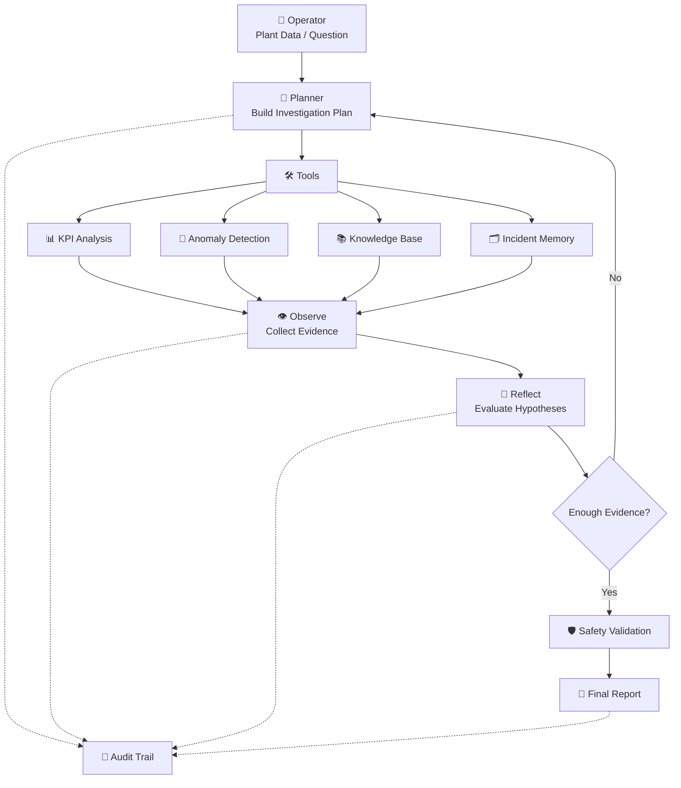

<div align="center">

# 🌊 AquaMindAI-Agent

### Autonomous AI Agent for Desalination Operations Intelligence

**Monitor · Investigate · Diagnose · Verify**

[](https://aquamindai-agent-git-main-mohammed-tariq1.vercel.app/)
[](https://www.python.org/)
[](./tests)
[](./tests)

**Evidence-grounded · Safety-constrained · Traceable**

[🚀 Live App](https://aquamindai-agent-git-main-mohammed-tariq1.vercel.app/) ·
[📋 Specification](./SPEC.md) ·
[💻 Source](./src) ·
[🧪 Tests](./tests) ·
[💰 Cost](./COST.md) ·
[🎬 Demo](./DEMO.md)

</div>

---

## Overview

**AquaMindAI-Agent** supports reverse-osmosis desalination operations by combining plant data, engineering knowledge, incident memory, and autonomous AI reasoning.

Unlike a conventional chatbot, AquaMind follows a structured investigation loop:

> **Plan → Act → Observe → Reflect → Decide**

---

## Architecture



[📋 Architecture & Agent Specification](./SPEC.md) ·
[💻 Inspect Implementation](./src) ·
[🧾 Execution Traces](./traces)

---

## Core Capabilities

| Capability | Explore |
|---|---|
| 🔎 Autonomous RO investigations | [Source](./src) |
| 📊 KPI & trend analysis | [Source](./src) |
| 🚨 Anomaly detection | [Source](./src) |
| 🧠 Evidence-based diagnostic reasoning | [Specification](./SPEC.md) |
| 📚 Engineering knowledge retrieval | [Source](./src) |
| 🗂️ Incident memory | [Source](./src) |
| 🔄 Reflection loop | [Source](./src) |
| 🛡️ Safety-aware recommendations | [Specification](./SPEC.md) |
| 🧾 Traceable audit trail | [Traces](./traces) |
| 💰 Cost tracking | [COST.md](./COST.md) |

---

## Example Investigation

```text
↓ Permeate Flow
↑ Differential Pressure
⚠ Abnormal RO Performance
```

AquaMind:

```text
Analyze KPIs
    ↓
Detect Anomalies
    ↓
Retrieve Engineering Knowledge
    ↓
Generate Hypotheses
    ↓
Reflect on Evidence
    ↓
Safety Check
    ↓
Recommended Action
```

Possible causes may include membrane fouling, scaling, hydraulic restrictions, feed-water changes, or pretreatment degradation.

[🚀 Try the Guided Demo](https://aquamindai-agent-git-main-mohammed-tariq1.vercel.app/) ·
[🎬 Demo Guide](./DEMO.md)

---

## Quality & Verification

| Check | Status |
|---|---:|
| Automated Tests | ✅ 42 / 42 |
| Test Coverage | ✅ 100% |
| Agent Loop | ✅ Implemented |
| Reflection | ✅ Implemented |
| Safety Controls | ✅ Implemented |
| Cost Tracking | ✅ Documented |
| Public Deployment | ✅ Live |

[🧪 View Tests](./tests) ·
[💰 Cost Tracking](./COST.md) ·
[🌐 Open Production App](https://aquamindai-agent-git-main-mohammed-tariq1.vercel.app/)

---

## Repository

```text
AquaMindAI-Agent/
├── src/              # Agent logic
├── tests/            # Automated tests
├── traces/           # Execution traces
├── web_app.py        # Web application
├── SPEC.md           # Agent specification
├── COST.md           # Cost tracking
├── DEMO.md           # Demo guide
├── requirements.txt
└── .env.example
```

[💻 `src/`](./src) ·
[🧪 `tests/`](./tests) ·
[🧾 `traces/`](./traces) ·
[🌐 `web_app.py`](./web_app.py) ·
[⚙️ `.env.example`](./.env.example)

---

## Run Locally

```bash
git clone https://github.com/xmohamedtariq/AquaMindAI-Agent.git
cd AquaMindAI-Agent

python -m venv .venv
.venv\Scripts\activate

pip install -r requirements.txt
python web_app.py
```

Run tests:

```bash
pytest --cov=src --cov-report=term-missing
```

Expected:

```text
42 / 42 tests passed
Coverage: 100%
```

---

## Safety

AquaMind is designed for **engineering decision support**.

It prioritizes:

**Evidence · Traceability · Safety · Engineering Context · Human Oversight**

It does not autonomously control physical desalination equipment.

---

## Documentation

| Resource | Purpose |
|---|---|
| [📋 SPEC.md](./SPEC.md) | Agent design and constraints |
| [💻 src/](./src) | Core implementation |
| [🧪 tests/](./tests) | Verification |
| [🧾 traces/](./traces) | Execution evidence |
| [💰 COST.md](./COST.md) | Cost tracking |
| [🎬 DEMO.md](./DEMO.md) | Demo workflow |
| [🚀 Live App](https://aquamindai-agent-git-main-mohammed-tariq1.vercel.app/) | Production deployment |

---

<div align="center">

### Mohammed Tariq Al-Sakkaf

**Mechatronics Engineer · Artificial Intelligence · Intelligent Automation · Water Technology**

[](https://github.com/xmohamedtariq)

<br>

### 🌊 Intelligence for Smarter Desalination Operations

</div>
