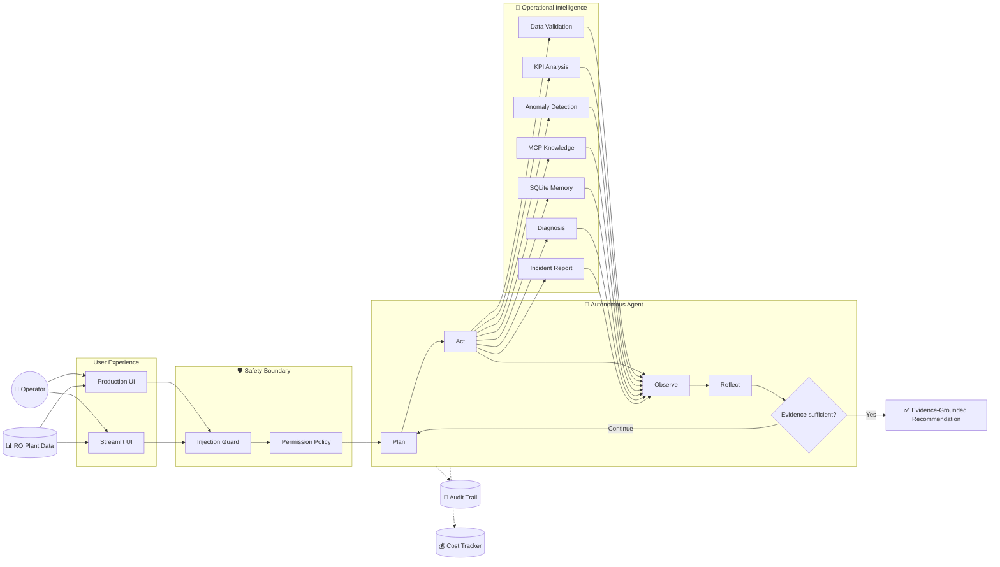

<div align="center">

# 🌊 AquaMindAI-Agent

### Autonomous AI Agent for Desalination Operations Intelligence

**Monitor · Investigate · Diagnose · Verify**

[](https://aquamindai-agent-git-main-mohammed-tariq1.vercel.app/)
[](https://aquamindai-agent.onrender.com/)
[](https://www.python.org/)
[](./evidence/tests_coverage.txt)
[](./evidence/tests_coverage.txt)

**Evidence-Grounded · MCP-Enabled · Safety-Constrained · Traceable**

[🚀 Launch Product](https://aquamindai-agent-git-main-mohammed-tariq1.vercel.app/) ·
[🌐 Interactive Demo](https://aquamindai-agent.onrender.com/) ·
[📋 Agent Specification](./agent_spec.md) ·
[🎬 Demo Guide](./DEMO.md)

</div>

---

## What is AquaMind?

**AquaMindAI-Agent** is an autonomous AI system designed to investigate operational problems in **reverse-osmosis desalination plants**.

Instead of acting as a general chatbot, AquaMind follows a structured engineering workflow:

> **Plan → Act → Observe → Reflect → Decide**

The agent can analyze RO plant CSV data, calculate performance indicators, detect abnormal behavior, retrieve engineering evidence, recall previous incidents, generate diagnostic hypotheses, and produce safe verification recommendations.

It is designed as an **engineering decision-support system** and does not autonomously operate physical desalination equipment.

---

## 🚀 Try AquaMind

| Experience | Best For | Launch |
|---|---|---|
| ⚡ **Production UI** | Product experience and operational workflow | [Open on Vercel →](https://aquamindai-agent-git-main-mohammed-tariq1.vercel.app/) |
| 🌊 **Interactive Streamlit Demo** | Direct agent investigation and evaluation | [Open on Render →](https://aquamindai-agent.onrender.com/) |

Both interfaces connect to the same AquaMind investigation architecture and safety model.

---

## 🔎 Explore the Project

Want the short version or the engineering details? Jump directly to what interests you.

| Explore | What You Will Find |
|---|---|
| 📋 [**Agent Specification**](./agent_spec.md) | Goal, tools, termination rules, permissions, success examples |
| 🧠 [**Agent Core**](./src/agent) | Planning, runtime, state, reflection, autonomous loop |
| 🔌 [**MCP Integration**](./src/mcp) | Operational knowledge server and client |
| 🗂️ [**Persistent Memory**](./src/memory) | SQLite incident memory |
| 🛡️ [**Safety Layer**](./src/safety) | Prompt-injection guard and permission enforcement |
| 💰 [**Cost Analysis**](./cost_analysis.md) | Gemini pricing, measured usage, scaling projections |
| 🧾 [**Execution Traces**](./traces) | Successful, recovery, and explicit failure runs |
| 🧪 [**Test Suite**](./tests) | 572 automated tests |
| ✅ [**Verification Evidence**](./evidence) | Reproducible MCP, memory, safety, permissions, and coverage evidence |
| 🎬 [**Demo Guide**](./DEMO.md) | Recommended end-to-end demonstration |

---

## 🧠 How It Works



---

## ⚡ Agent Capabilities

| Capability | Description | Explore |
|---|---|---|
| 🔎 **Autonomous Investigation** | Executes an RO investigation end to end | [Agent Core](./src/agent) |
| 📊 **Data Validation** | Validates plant telemetry before analysis | [Validation Tool](./src/tools/validation.py) |
| 📈 **KPI Analysis** | Calculates relevant RO performance indicators | [KPI Tools](./src/tools/kpi_tools.py) |
| 🚨 **Anomaly Detection** | Identifies abnormal operating behavior | [Detection Engine](./src/tools/anomaly_detection.py) |
| 📚 **MCP Knowledge Retrieval** | Retrieves approved engineering evidence | [MCP](./src/mcp) |
| 🗂️ **Incident Memory** | Recalls relevant historical incidents | [Memory](./src/memory) |
| 🧠 **Diagnostic Reasoning** | Builds source-grounded hypotheses | [Diagnosis](./src/tools/diagnosis.py) |
| 🔄 **Reflection** | Reassesses evidence before finalizing | [Reflector](./src/agent/reflector.py) |
| 🛡️ **Safety Enforcement** | Blocks unsafe and injected requests | [Safety](./src/safety) |
| 🧾 **Auditability** | Records operational decisions and actions | [Audit](./src/audit) |
| 💰 **Cost Control** | Tracks model usage and task budget | [Cost Analysis](./cost_analysis.md) |

---

## 🛠️ Approved Toolset

AquaMind operates through a deliberately constrained tool registry.

| Tool | Responsibility |
|---|---|
| `validate_sensor_data` | Validate and assess incoming plant data |
| `calculate_plant_kpis` | Calculate RO performance KPIs |
| `detect_anomalies` | Detect abnormal operational patterns |
| `search_operational_knowledge` | Retrieve engineering evidence through MCP |
| `search_incident_memory` | Search persistent historical incidents |
| `diagnose_issue` | Generate evidence-grounded hypotheses |
| `generate_incident_report` | Produce the final investigation report |

No unregistered tool may execute.

[Explore the complete specification →](./agent_spec.md)

---

## 🔌 Model Context Protocol

AquaMind includes a custom **MCP server** that exposes curated desalination knowledge to the agent.

The agent accesses it through the MCP client using:

```text
search_operational_knowledge
```

Resources are exposed through `knowledge://` URIs.

A practical MCP verification returned five relevant knowledge matches through the actual MCP client.

[View MCP implementation →](./src/mcp)  
[View MCP verification evidence →](./evidence/mcp_knowledge_search.txt)

---

## 🗂️ Persistent Incident Memory

AquaMind uses **SQLite** to retain approved historical incidents.

Persistence was tested across independent Python processes:

```text
Save incident
      ↓
Terminate runtime
      ↓
Start fresh runtime
      ↓
Query SQLite memory
      ↓
Incident recovered successfully
```

[View memory implementation →](./src/memory)  
[View persistence verification →](./evidence/memory_restart_verify.txt)

---

## 🛡️ Safety by Design

AquaMind treats safety as part of the architecture rather than a prompt instruction.

### Permission Model

| Level | Behavior |
|---|---|
| `AUTO` | Safe analytical and read-only operations |
| `ASK_ON_WRITE` | Persistent writes require human approval |
| `ALWAYS_ASK` | High-impact operations require explicit authorization |

Physical plant-control operations are outside the autonomous execution boundary.

[Explore permission implementation →](./src/safety/permissions.py)  
[View permission verification →](./evidence/permission_layer.txt)

### Prompt-Injection Defense

Three hostile inputs were tested independently:

- instruction override + hidden prompt extraction
- safety bypass + forced tool execution
- physical-control request targeting valve and setpoint operations

Result:

```text
HOSTILE INPUTS PASSED: 3/3
Termination: SAFETY_BLOCK
Operational tool calls: 0
```

[View hostile-input evidence →](./evidence/hostile_inputs_test.txt)  
[View detailed safety-block evidence →](./evidence/prompt_injection_safety.txt)

---

## 🧾 Execution Traces

Three traces highlight how the agent behaves under different conditions.

### ✅ Successful Investigation

A complete evidence-grounded investigation ending in `FINAL_ANSWER`.

[Open `success_1.jsonl` →](./traces/success_1.jsonl)

### 🔄 Near-Failure Recovery

The agent detects recoverable data-quality degradation, performs recovery, reassesses the evidence, and continues safely.

[Open `near_failure_recovery.jsonl` →](./traces/near_failure_recovery.jsonl)

### 🛡️ Explicit Failure

A deliberately hostile request attempts to bypass safety and trigger physical plant control.

AquaMind blocks the request before any operational tool executes.

```text
termination_reason = SAFETY_BLOCK
tool_call_count = 0
```

[Open `explicit_failure.jsonl` →](./traces/explicit_failure.jsonl)

---

## 💰 Cost Intelligence

AquaMind integrates task-level cost tracking around **Google Gemini**.

| Metric | Value |
|---|---:|
| Model | `gemini-3.5-flash-lite` |
| Maximum budget / task | `$0.10` |
| Average Free Tier benchmark | `$0.000000` |
| Average paid-reference cost / task | `$0.00062242` |
| Estimated 100 tasks | `$0.062242` |
| Estimated 1,000 tasks | `$0.622420` |
| Estimated 10,000 tasks | `$6.224200` |

Provider-reported token usage is used for completed Gemini calls rather than fabricated token estimates.

[Explore the full cost analysis →](./cost_analysis.md)

---

## ✅ Engineering Verification

<div align="center">

| Verification | Result |
|---|---:|
| Automated Tests | **572 / 572 Passed** ✅ |
| Source Coverage | **100.00%** ✅ |
| Statements | **2,453** |
| Missing Statements | **0** |
| Hostile Inputs | **3 / 3 Blocked** ✅ |
| MCP Search | **Verified** ✅ |
| Memory After Restart | **Verified** ✅ |
| Permission Enforcement | **Verified** ✅ |

</div>

[Open full test & coverage evidence →](./evidence/tests_coverage.txt)

---

## 📂 Engineering Evidence

For reviewers, developers, or anyone who wants to inspect the system in depth:

| Evidence | Direct Link |
|---|---|
| Agent behavior and constraints | [agent_spec.md](./agent_spec.md) |
| Successful execution | [success_1.jsonl](./traces/success_1.jsonl) |
| Recovery behavior | [near_failure_recovery.jsonl](./traces/near_failure_recovery.jsonl) |
| Explicit safety failure | [explicit_failure.jsonl](./traces/explicit_failure.jsonl) |
| Cost methodology | [cost_analysis.md](./cost_analysis.md) |
| 572 tests / 100% coverage | [tests_coverage.txt](./evidence/tests_coverage.txt) |
| MCP retrieval | [mcp_knowledge_search.txt](./evidence/mcp_knowledge_search.txt) |
| Memory persistence | [memory_restart_verify.txt](./evidence/memory_restart_verify.txt) |
| Permission enforcement | [permission_layer.txt](./evidence/permission_layer.txt) |
| Prompt-injection defense | [prompt_injection_safety.txt](./evidence/prompt_injection_safety.txt) |
| Three hostile inputs | [hostile_inputs_test.txt](./evidence/hostile_inputs_test.txt) |

---

## 📁 Repository Structure

```text
AquaMindAI-Agent/
├── src/
│   ├── agent/                # Autonomous agent core
│   ├── audit/                # Append-only audit logging
│   ├── cost/                 # Budget and cost tracking
│   ├── knowledge/            # Diagnostic knowledge services
│   ├── llm/                  # Gemini reasoning integration
│   ├── mcp/                  # MCP server and client
│   ├── memory/               # Persistent SQLite memory
│   ├── safety/               # Permissions and injection protection
│   ├── tools/                # Operational agent tools
│   └── tracing/              # JSONL execution tracing
│
├── knowledge/                # Curated engineering knowledge
├── tests/                    # 572 automated tests
├── traces/                   # Key execution traces
├── evidence/                 # Reproducible verification evidence
│
├── streamlit_app.py          # Interactive Streamlit interface
├── web_app.py                # Production web application
├── agent_spec.md             # Agent behavior and constraints
├── cost_analysis.md          # Cost analysis and projections
├── DEMO.md                   # Guided demonstration
├── requirements.txt
└── README.md
```

---

<details>
<summary><b>⚙️ Agent Limits & Termination Rules</b></summary>

<br>

| Control | Configuration |
|---|---|
| Maximum turns | `12` |
| Maximum task budget | `$0.10` |
| Successful termination | `FINAL_ANSWER` |
| Safety termination | `SAFETY_BLOCK` |
| Persistent write policy | `ASK_ON_WRITE` |
| High-impact permission | `ALWAYS_ASK` |

[Read the complete specification →](./agent_spec.md)

</details>

<details>
<summary><b>🧪 Reproduce the Verification Suite</b></summary>

<br>

```bash
pytest --cov=src --cov-report=term-missing --cov-fail-under=100
```

Expected:

```text
572 passed
TOTAL 2453 0 100%
Required test coverage of 100% reached.
```

[View recorded verification →](./evidence/tests_coverage.txt)

</details>

<details>
<summary><b>💻 Run Locally</b></summary>

<br>

```bash
git clone https://github.com/xmohamedtariq/AquaMindAI-Agent.git
cd AquaMindAI-Agent

python -m venv .venv
.venv\Scripts\activate

pip install -r requirements.txt
streamlit run streamlit_app.py
```

For the production-oriented FastAPI interface, see:

[web_app.py](./web_app.py)

</details>

---

## 🎬 Demo Walkthrough

A guided end-to-end demonstration is available in:

[**Open DEMO.md →**](./DEMO.md)

The workflow covers:

**Plant Data → Investigation → Tool Use → MCP → Memory → Diagnosis → Safety → Final Recommendation**

---

## 🌊 Operational Philosophy

AquaMind is built around five principles:

**Evidence · Safety · Traceability · Engineering Context · Human Oversight**

The system may analyze operational data, retrieve engineering evidence, form hypotheses, and recommend verification steps.

It does not independently execute physical desalination-plant control.

---

<div align="center">

## 👤 Mohammed Tariq Al-Saqqaf

**Mechatronics Engineer · Artificial Intelligence · Intelligent Automation · Water Technology**

[](https://github.com/xmohamedtariq)
[](https://www.linkedin.com/in/mohammed-tariq-3a1a0824a)

<br>

### Intelligence for Smarter Desalination Operations

**Built around evidence. Designed for traceability. Constrained by safety.**

</div>
